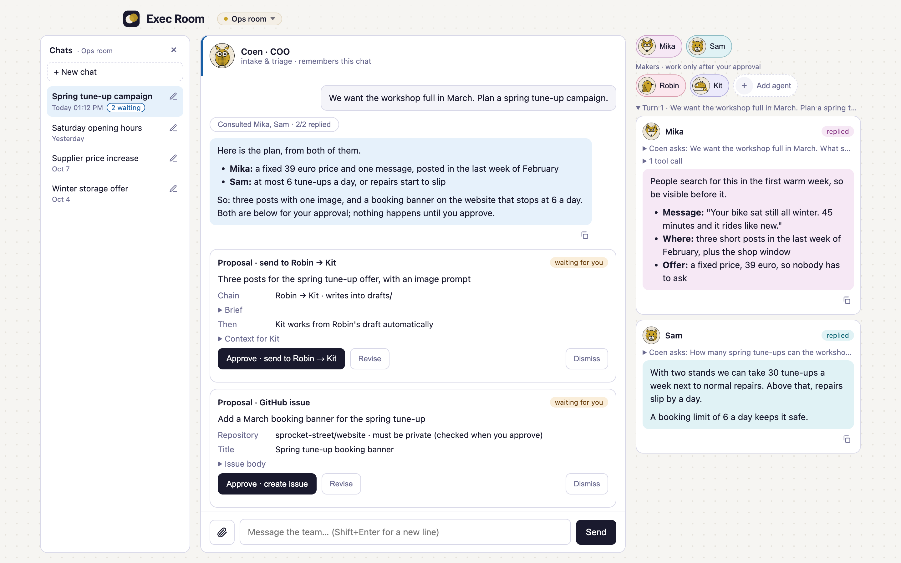
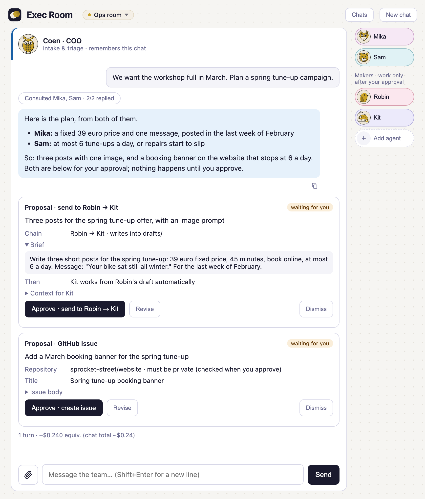
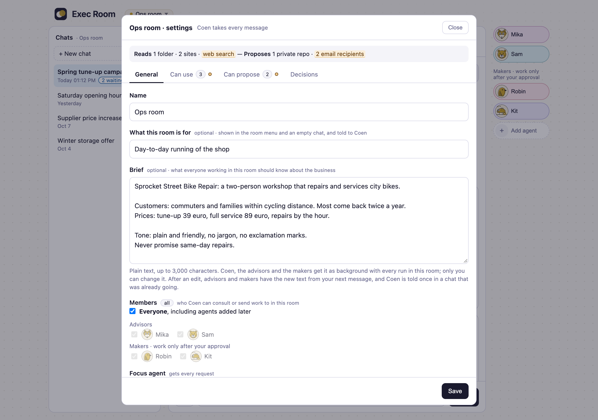
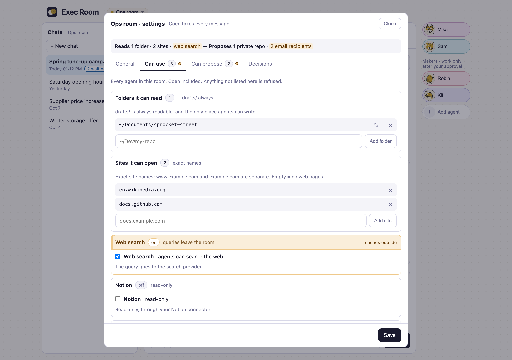
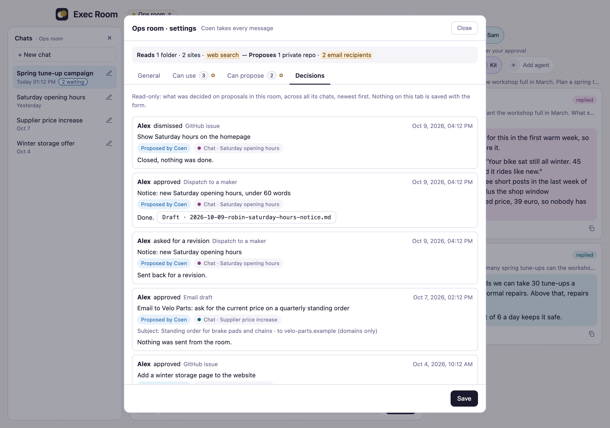
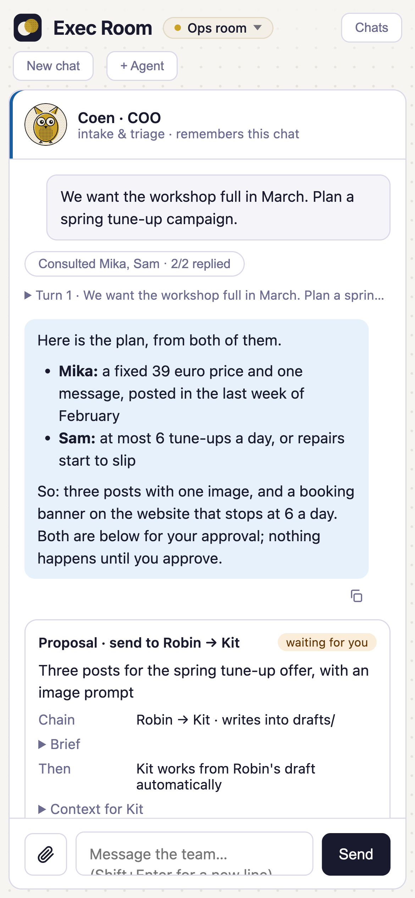

# Exec Room

[](LICENSE)
[](https://nodejs.org)
[](https://code.claude.com/docs)
[](SECURITY.md)
[](SECURITY.md)

Exec Room is an open-source agent room for running a business: a local web room where you, the exec, work with a team of Claude Code agents. They research, draft and propose actions (GitHub issues, Notion pages, email drafts, jobs for other agents). They can't run commands on your computer, and nothing happens until you approve it.



The room starts with one agent: **Coen**, the room lead. Every message goes to him first. You build the rest of the team yourself, in the room:

- **Advisors** — Coen consults them before he answers (for example a technical or a marketing advisor).
- **Makers** — they do a job after you approve it and save the result as a draft (for example a writer or an image-prompt maker).

Each agent gets a name, a job description, instructions, the tools it may use and an avatar from the preset set.

## Features

- **Approve before act** — agents propose; you approve each action on a card, then the server carries it out
- **Rooms** — separate chats, each with its own members, its own limits on what agents may read and propose, and a one-line description of what the room is for
- **A brief per room** — what every agent in the room should know about your business (customers, pricing, tone), written by you in Room settings and given to Coen, every advisor and every maker as background
- **Chat list** — every chat in a room is kept; go back to one from the Chats panel and give it a name
- **GitHub** — issues and comments in the repos you allow per room (private repos only, unless you mark one as public)
- **Notion** — posts saved as drafts in databases you configure, and long-form pages under pages you allow
- **Email drafts** — to recipients you allow; the room never sends mail, you do
- **Attach a file to a message** — text, PDF or images; agents can read it for that turn only, then the room deletes it
- **Claude plan or API key** — runs use your Claude plan by default; start the room with `npm run room:key` to pay with an Anthropic API key instead, with a spend cap per run and per day
- **Local and locked down** — binds to 127.0.0.1, read-only tools, writes only in `drafts/`, secret files blocked
- **Keyboard and screen reader** — everything is reachable with the keyboard, and a screen reader is told when a turn ends and when a proposal is waiting (see [Accessibility](#accessibility))


## Screenshots

The pictures show a demo install with a made-up bike repair shop; every name and number in them is invented.

**Approve before act.** Coen asked two advisors, then proposed a job for two makers and a GitHub issue. Nothing happens until you approve; you can also send a proposal back with a note or dismiss it.



**A brief per room.** What every agent in the room should know about the business, written by you.



**What a room can use.** Folders, sites, web search and connectors are set per room; anything not listed is refused.



**Decisions.** Every proposal you approved, sent back or dismissed in the room, across its chats.



**Narrow windows.** The same room in a phone-width window; the chat list opens as a drawer.



## What it costs

The room runs on your own Claude plan. Every message, every advisor Coen consults and every maker run is a Claude Code run that spends your plan's usage. Two jobs can run at the same time (in different rooms), which uses it up faster. The room keeps the cost Claude Code reports per message and per chat, but it sets no budget and no limit of its own.

Started on an API key instead (see [Running on an API key](#running-on-an-api-key)), every run is billed to that key, pay-as-you-go. There the room does set limits: at most $2 per run and $10 per day unless you change them, and the cost it shows is real spend.

## Requirements

- **macOS or Linux.** Windows isn't supported.
- **Node.js 20+**
- **Claude Code** (`claude`), signed in to your Claude plan (tested with version 2.1.285) — see the [Claude Code docs](https://code.claude.com/docs). By default the room runs agents on your plan and never uses an Anthropic API key; to pay with a key instead, see [Running on an API key](#running-on-an-api-key) (no plan sign-in is needed for that). It starts every run with `--agents`, `--tools`, `--setting-sources` and `--disable-slash-commands`, so it needs a recent version that has all four.
- **Python 3** — only to run the tests
- Optional: **GitHub CLI** (`gh`), signed in, for GitHub actions
- Optional: a **Notion integration token**, for Notion actions
- Optional: the **Notion** and **Microsoft 365** connectors on your claude.ai account, if agents should read Notion or search your Outlook mail. Agents read through those connectors; the integration token is used by the server (saving drafts and pages, checking where a page sits), never by agents. So a room's Notion and Microsoft 365 switches do nothing until the connector is connected.

## Quick start

```bash
git clone https://github.com/ANDRS-Projects/exec-room.git
cd exec-room
./setup.sh        # checks the requirements, installs dependencies, creates room.config.json, offers to start the room
```

Then open http://127.0.0.1:4179. Stop the room with Ctrl-C; start it again later with `npm run room`.

Click **Add agent** to build your first advisor or maker, and **Room settings** to choose what the room may read, which sites it may open, and what it may propose. Its **Decisions** tab lists every proposal you approved, sent back or dismissed in that room, across all its chats: who decided, which agent proposed it, in which chat, when, and what came of it. The **Chats** panel lists the room's chats; picking one opens it with its history. Coen picks up where he left off as long as Claude Code still has its own log of that chat (about 30 days after the last message, unless you changed Claude Code's `cleanupPeriodDays`); an older chat is marked "history only" and Coen starts fresh there.

## Running on an API key

By default every run uses your Claude plan. To pay with an Anthropic API key instead (pay-as-you-go), give the room the key and start it in key mode:

```bash
export ROOM_ANTHROPIC_API_KEY=sk-ant-...     # or: export ROOM_ANTHROPIC_API_KEY_REF="op://vault/item/field" (read with 1Password's `op read`)
npm run room:key
```

The choice is made when the room starts and holds until you stop it: the plan and a key never run side by side. `npm run room` starts it on your plan again. A key that merely sits in your environment (`ANTHROPIC_API_KEY`) is never used.

| Variable | What it's for |
|----------|---------------|
| `ROOM_ANTHROPIC_API_KEY` | The key. Read once at start-up, kept in memory, handed to the agent runs only. It is never written to `data/`, the job log or the page, and the page has no field for it. |
| `ROOM_ANTHROPIC_API_KEY_REF` | Instead of the key itself: a 1Password reference the room reads once with `op read`. |
| `ROOM_RUN_CAP_USD` | The most one run may spend (default 2). Claude Code checks it after each turn, so a run can pass it by one turn. |
| `ROOM_DAY_CAP_USD` | The most all runs may spend in a day (default 10). Once it is reached nothing starts until the next day, including the turns the room starts itself. |

What is different in key mode:

- **Agents have no Notion or Microsoft 365 tools.** They read those through the claude.ai connectors of a Claude plan sign-in, and key-mode runs don't use that sign-in. A room's settings are kept for when it runs on the plan. Saving Notion drafts and pages (the integration token) and email drafts still work.
- **Notion pages you link are read for them.** In a room with Notion reading on, put the link of a Notion page or database in your message and the room reads it with your integration token and hands it to the agents (you see a notice saying what was read). Up to three links per message, and only what is shared with your integration.
  - **A page** comes with its text and its properties, so a row of a database (a post, say) arrives with its content.
  - **A database** comes with its row count, an overview with one line per row (title and short columns, for up to its 500 most recently edited rows) and its newest rows in full, so agents can count, filter and find rows across the table. For an older row in full, link that row.
  - Agents can't search Notion or follow links inside a page themselves, and Microsoft 365 mail is not available on a key.
- **Chats don't carry over.** A chat last used on the plan starts fresh on the key, and the other way round; the room says so and the history stays.
- **The cost is spend.** The page shows an "API key" badge next to the room's name, and a run's cost reads "$0.012 API spend" instead of "~$0.012 equiv.".
- **Key-mode runs keep their own Claude Code folder** (`data/claude-key`), without your plan sign-in. With a plan sign-in present Claude Code uses the plan and not the key, so this is what makes the key the one that pays.

Without a key the room does not start in key mode. See [SECURITY.md](SECURITY.md) for how the key is handled.

## Configuration

Most settings live in the room itself (Room settings), per room: folders agents may read, web search, sites they may open, Notion and Microsoft 365 access, GitHub repos, Notion pages and email recipients. A new room starts with nothing beyond `drafts/`.

`room.config.json` (created from `room.config.example.json`, gitignored) only holds what the whole install needs:

| Key | What it's for |
|-----|---------------|
| `notionTokenRef` | A 1Password reference (`op://vault/item/field`) read once at start-up with `op read`. Or set `ROOM_NOTION_TOKEN` instead. Without a token, Notion actions are off. |
| `notionDatabases` | The Notion databases posts can be saved to, e.g. `{"social": {"name": "Social posts", "id": "<database id>", "accounts": ["Personal", "Company"]}}`. Each needs the properties Name (title), Status (status, with a `draft` option), Channel and Post Content (text), and optionally Account (select), Image Prompt and Source Insight (text). |
| `notionChannels` | The channel names a post may have (default: X, LinkedIn, Substack Note, Substack Post, Instagram, Blog). |
| `hiddenConnectors` | Other claude.ai connectors on your account to keep out of the agents' view, by the name in their tool names (`mcp__claude_ai_<name>__…`), e.g. `["My_Connector"]`. Agents can only call the tools a room allows; connectors that aren't hidden are still visible to them, so this keeps the rest out of their context. Claude Docs, Gmail, Slack, Google Drive and Google Calendar are always hidden. `Notion` and `Microsoft_365` can't be listed, as those are switched per room: such an entry is skipped with a warning at start-up, like an entry that isn't a connector name. |
| `agentsGetClaudeFiles` | Whether agents are given Claude Code's own files, as any Claude Code session started in the room's folder would be: the `CLAUDE.md` files of that folder and the folders above it (this repo's notes for contributors, your personal `~/.claude/CLAUDE.md`, anything other tools write into such files) and the memory Claude Code keeps for the folder. Default `false`: agents get only what the room gives them (their own description, the room's note and brief, your message), and the room checks at every start that this still holds, with one small run that costs about a cent; `ROOM_CONTEXT_CHECK=off` skips that check. Set it to `true` if you keep instructions in `CLAUDE.md` that the agents should follow too; every agent in every room then gets all of those files, whatever else they say. |
| `ownerName` | Your name as decisions are recorded under it: "approved by …" on a proposal card, the Decisions tab in Room settings, and the credit line on what an approved proposal creates (default: "the owner"). One line, up to 60 characters. It is a label, not a login. |

Share the databases and pages with your Notion integration. Posts are always saved with Status `draft`; publishing stays with you.

Environment variables are listed in `.env.example`. The server reads them from your shell; it does not load a `.env` file.

## Your own agents

**Import.** Already have agents for Claude Code in `~/.claude/agents` (as `<name>.md` or `<name>/AGENT.md`)? Click **Add agent** → **Import from ~/.claude/agents** and pick one. The room copies its name, description, model and instructions into the build form; you choose its role, tools and avatar there. It's a one-time copy: later changes to the file don't reach the room, and a `tools:` line in the file is ignored, so a file can never give an agent more access than you chose.

**Export.** Agents you build in the room are stored in `data/agents.json`. To use one outside the room too, open it and choose **Export as AGENT.md**: the room saves it in `drafts/` and shows the command to copy it into your own `~/.claude/agents` folder. The room never writes there itself.

**Readable in every room.** Runs start in the folder you cloned the room into, so every agent in every room can read that folder, whatever folders the room has: the room's own code and docs, `room.config.json` (your Notion database ids and the 1Password reference to the token, not the token itself), and `drafts/`, including drafts written in other rooms. Only `data/`, secret-looking files (`.env`, keys and the like) and `.git` are excluded. Every agent can also read `~/.claude/agents`, `~/.claude/skills` and `~/.claude/knowledge` (and what those folders link to). Keep nothing in any of these places that an agent in another room shouldn't see.

## Accessibility

The room is built to be usable with a keyboard and a screen reader. It has not been audited, and it makes no claim of conformance to WCAG.

**Keyboard.** The controls are buttons, links and fields in the page's own order, so Tab reaches them and each shows a focus ring. Enter sends a message and Shift+Enter starts a new line. The tabs in Room settings move with the arrow keys; Escape closes the room switcher, the chat list on a narrow window, the dialogs and the Dismiss form on a proposal card. When a turn starts, focus stays in the message box.

**Screen reader.** While a turn runs, a screen reader is told only what matters, in a short sentence each time: that your message went out, that a focus agent took over, how the turn ended ("Coen replied.", or who was consulted and how many replied), that a proposal is waiting for your decision, how an approved action ended, and any notice or error the room shows in the chat (a proposal that couldn't be used, a run that failed, a message that wasn't sent). The text of a reply is not read out as it streams in: read it in the chat when the turn is over. Opening a saved chat announces nothing. The agents in the rail are two groups, advisors and makers, and each agent's button is labelled with its name and what it does.

**Reading.** The state of a proposal, a consulted agent or a chat is written out in a label ("waiting for you", "done", "failed"), not shown by colour alone. Those labels are 12px or larger, the fields you type in have an edge at 3:1 against white, and the pulsing "working" dots stand still when your system asks for reduced motion.

**Known gaps.** The spoken updates were checked by reading what the page hands to a screen reader, not yet in a full session with VoiceOver or NVDA. The outlines of cards, buttons and agent chips are lighter than 3:1; buttons and chips carry a text label, so the outline is not the only cue. Some secondary text is 11px. A room that is working elsewhere shows a dot in the room switcher, with "Working now" only as hover text. There is no dark mode and no high-contrast theme. If something doesn't work with your setup, please open an issue.

## Tests

```bash
npm test
```

665 checks run the server against fake `claude`, `gh` and Notion stand-ins in `tests/fakes/`, so they need no network, accounts or credits. Expected output: `ok: all 671 checks match tests/expected.txt`.

## Security

See [SECURITY.md](SECURITY.md) for the full model. In short: the room binds to localhost and rejects other hosts and origins; agents get read-only tools (never Bash, the tool that runs commands), write only in `drafts/`, and can't read secret files (`.env`, keys, `.git`) or the room's own data; every action is a proposal you approve. Agents are given only what the room gives them: your own `CLAUDE.md` files and the memory Claude Code keeps for a folder are not loaded for them unless you turn that on (`agentsGetClaudeFiles`, see Configuration), and the room checks that at every start.

**These are permission rules, not a sandbox.** The blocks work by name: tool names, folder paths and file-name patterns, passed to Claude Code as allow and deny rules. Nothing isolates the agents from your machine at the operating-system level, so a secret in a file with a name that isn't on the list, inside a folder you gave a room, is readable. Everything agents read can also carry prompt injection: files, web pages, Notion pages, GitHub issues and pull requests, and mail previews can contain text that tries to steer an agent. Give each room only what its job needs, and read a proposal before you approve it.

To report a vulnerability, use **Report a vulnerability** on the repository's Security tab rather than a public issue.

## Contributing

See [CONTRIBUTING.md](CONTRIBUTING.md). Working on the room with Claude Code? [CLAUDE.md](CLAUDE.md) has the commands and architecture.

## License

Exec Room is licensed under the GNU Affero General Public License, version 3 only (SPDX: `AGPL-3.0-only`) — see [LICENSE](LICENSE).

Copyright (C) 2026 ANDRS Projects Europe B.V.

**Commercial license.** Organisations that cannot, or prefer not to, use Exec Room under the AGPL can get it under a separate commercial license. See [COMMERCIAL.md](COMMERCIAL.md) or write to legal@andrs.nu.

The AGPL covers Exec Room and works based on it; agent instructions, room settings and data you write yourself, without copying from Exec Room's own files, do not come under the AGPL by being used with it (this explains the license; it is not an additional permission).

**Claude and Anthropic.** Exec Room contains no AI model. Agents run through Claude Code, a separate program from Anthropic that you install yourself; your use of Claude Code and the Claude models is under your own agreement with Anthropic, and the Exec Room license gives no rights to them. Exec Room is an independent project, not affiliated with or endorsed by Anthropic; "Claude" and "Anthropic" are trademarks of Anthropic, PBC.

Third-party parts keep their own licenses: the Inter font in `public/vendor/inter/` (SIL Open Font License 1.1, see [LICENSE.txt](public/vendor/inter/LICENSE.txt)), and the `marked` (MIT) and `DOMPurify` (MPL-2.0 OR Apache-2.0) builds in `public/vendor/`; the `DOMPurify` build also contains `regenerator-runtime` (MIT). Their notices and license texts are in [THIRD-PARTY-NOTICES.md](THIRD-PARTY-NOTICES.md).
